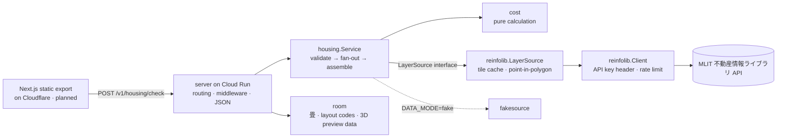

# Kurashi Nav — "Should I sign this lease?"

A housing check for foreign residents in Japan. Drop a pin on the home you are
about to rent and enter the agent's estimate; get back, in English, Korean or
やさしい日本語:

- **Hazards** — flood, storm surge, tsunami, landslide and liquefaction areas
- **Area context** — zoning (用途地域) and public school districts
- **Nearby transaction prices** — what similar homes sold for nearby
- **Initial-cost breakdown** — what 敷金・礼金・仲介手数料・保証料 are, the total, and
  questions worth asking (e.g. a brokerage fee above the legal cap)
- **Room size you can feel** — 畳 ↔ ㎡ ↔ 평 ↔ sq ft, layout codes (1K, 2LDK, 3SLDK…)
  explained, and data for a to-scale 3D preview of the room with typical
  furniture. Built from the numbers on the listing, never from listing photos.

All location data comes from official open data via the MLIT
**不動産情報ライブラリ API**. No user input is stored.

> **日本語:** 日本で部屋を借りる外国人向けに、物件の位置と見積書から「災害リスク・用途地域・学区・周辺取引価格・初期費用の内訳」を多言語で説明する Web サービスのバックエンドです（Go）。
>
> **한국어:** 일본에서 집을 구하는 외국인을 위한 "이 집, 계약해도 될까?" 판단 서비스의 Go 백엔드입니다.

**Status:** backend skeleton — runs end-to-end on dummy data; live MLIT
integration is wired and tested against a mock server, pending API key.

---

## Quick start

Requires Go 1.27+. No API key or external services needed.

```sh
make run          # starts on :8080 with dummy data (DATA_MODE=fake)
make check        # gofmt + go vet + tests with the race detector
```

```sh
curl -s localhost:8080/healthz

curl -s -X POST localhost:8080/v1/housing/check \
  -H 'Content-Type: application/json' \
  -d '{
        "lat": 35.681236, "lon": 139.767125, "lang": "en",
        "cost": {
          "rent_yen": 80000, "management_fee_yen": 5000,
          "deposit_months": 1, "key_money_months": 1, "brokerage_months": 1,
          "guarantee_rate": 0.5, "fire_insurance_yen": 20000, "key_exchange_yen": 16500
        }
      }'
```

To use real data, apply for an API key at the 不動産情報ライブラリ site, copy
`.env.example` to `.env`, set `REINFOLIB_API_KEY`, and run `make run-live`.

## Development

Built with Claude Code in VS Code. `CLAUDE.md` holds the project rules every
session loads; `.claude/` holds shared permissions, a gofmt hook and project
commands (`/next-task`, `/verify`, `/explain`, `/adr`). Scope and backlog:
[`docs/MVP.md`](docs/MVP.md) (Korean).

## API

| Method | Path | Purpose |
|---|---|---|
| `POST` | `/v1/housing/check` | Full report for one location (+ optional cost estimate) |
| `GET` | `/v1/room/size?jo=6&lang=ko` | 畳/㎡/평/sq ft, suggested shape, reference furniture (or `area_sqm=25`) |
| `GET` | `/v1/room/layout?code=2LDK&lang=en` | Layout code explained, with the DK/LDK minimum-size rule |
| `GET` | `/v1/meta/sources` | Data sources and the credit each requires |
| `GET` | `/healthz` | Liveness |

Errors share one shape: `{"error": {"code": "...", "message": "...", "request_id": "..."}}`.

The full contract is [`docs/openapi.json`](docs/openapi.json) (OpenAPI 3.0). A test
calls every endpoint and fails if a response no longer matches it.

## Architecture



```
cmd/api/            entry point: config → wiring → server → graceful shutdown
internal/
  server/           HTTP: routes, middleware, error → status mapping
  housing/          domain: the check itself, ports (interfaces), i18n
  cost/             initial-cost calculator (pure functions)
  room/             room sizes, layout codes, furniture presets (pure functions)
  i18n/             languages (en / ko / ja-easy) and message catalogues
  reinfolib/        MLIT API client + LayerSource adapter
  fakesource/       dummy LayerSource for local dev and tests
  geocode/          address → coordinate (static for now)
  geo/              points, XYZ tiles, GeoJSON, point-in-polygon
  parallel/         errgroup-style fan-out (re-implemented for learning)
  ratelimit/        token bucket for outgoing requests
  cache/            generic TTL cache
  config/ logging/  env config with secret redaction; Cloud Logging-ready JSON
docs/               ADRs, data sources, learning guide
infra/              deployment plan (phase 2)
```

Key decisions, each with an ADR in [`docs/adr`](docs/adr):

1. **Standard library first** — `net/http` routing, `log/slog`, hand-rolled errgroup/rate limiter.
2. **No user input is stored or logged** — caches are keyed by public map tiles, not by user coordinates.
3. **Partial results beat failure** — each layer has its own timeout; one slow source marks one section `unavailable`.
4. **Official data only** — public APIs and open data with attribution; no scraping.
5. **Map pin instead of geocoding** — address search is pluggable, not on the critical path.
6. **3D room preview from numbers, not photos** — listing photos are copyrighted; sizes typed by the user are not.
7. **Frontend on Cloudflare, API on Cloud Run** — Next.js static export served from the edge for free; Go stays on Cloud Run in Tokyo.

## Data and compliance

See [`docs/DATA_SOURCES.md`](docs/DATA_SOURCES.md) for every source, its terms
and the credit shown in the UI.

This service provides reference information only. It is not legal or
real-estate advice, does not broker properties (宅地建物取引業 is not
performed), and hazard information does not guarantee safety or danger.
Always confirm with the official municipal hazard map and the 重要事項説明.

## Roadmap

- [x] Backend skeleton: housing check, cost calculator, MLIT adapter, tests, CI
- [ ] Live data: verify property fields per API, human-readable hazard levels
- [x] Room size API: 畳 conversions, layout codes, furniture presets
- [ ] Frontend: Next.js + TypeScript, map pin (GSI tiles), i18n (en / ko / やさしい日本語),
      3D room preview (Three.js) from `/v1/room/size`
- [ ] Infra: frontend on Cloudflare Workers (static assets); API on Cloud Run (Tokyo) with
      Secret Manager, Terraform, CD — see [`infra/`](infra)
- [ ] Observability: OpenTelemetry traces per layer, pprof, load test
- [ ] Next module: public-system navigator for foreign residents (pension, health insurance, residence status)

## License

TBD (MIT planned). Data remains subject to each provider's terms.
