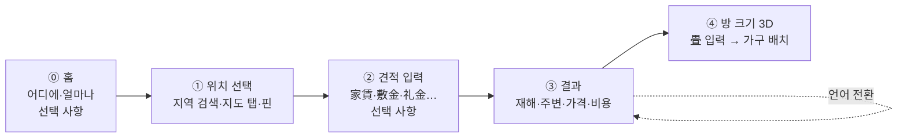
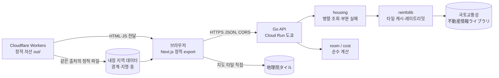

# MVP 설계서 — kuramiru 「이 집, 계약해도 될까?」

> 이 문서는 **설계(무엇을·왜)** 와 **백로그(무엇부터)** 를 함께 담습니다.
> VS Code 안의 Claude Code로 개발하는 것을 전제로 작성했습니다. Claude Code는
> 이 파일의 체크박스 백로그를 `/next-task`로 하나씩 처리합니다.
> 규칙·명령어는 루트의 `CLAUDE.md`, 결정 근거는 `docs/adr/`에 있습니다.

---

## 1. 한 줄 정의

일본에서 집을 구하는 외국인이 **지도에 핀을 찍고 견적서 숫자를 넣으면**,
재해 위험·주변 정보·초기비용·방 크기를 **자기 언어로** 설명해 주는 웹 서비스.

## 2. 문제와 사용자

| | 내용 |
|---|---|
| **문제** | 해저드맵·용도지역·초기비용 항목·間取り 표기가 전부 일본어 전문용어. 부동산 회사는 "계약하라"는 쪽이라 중립적 설명을 듣기 어렵다. |
| **페르소나 A** | 한국인 유학생·워홀러(20대). 일본어 N3~N2. 1K/1R, 월세 5~8만 엔. "敷金·礼金이 뭐고 이 금액이 정상이야?" |
| **페르소나 B** | 영어권 엔지니어(30대). 일본어 거의 못 함. 1LDK/2LDK. "이 동네 홍수 위험은? 6畳면 침대랑 책상 들어가?" |
| **사용 시점** | 내견(内見) 직후 ~ 계약 전 1~3일. 휴대폰으로 사용 → **모바일 우선**. |

## 3. MVP 범위

### 넣는 것 (In)

| # | 기능 | 백엔드 상태 |
|---|---|---|
| F1 | 위치 기반 재해 정보: 홍수·고조·쓰나미·토사·액상화 | ✅ 골격 완료, 실데이터 검증 필요 |
| F2 | 주변 정보: 용도지역, 초·중학교 학구 | ✅ 골격 완료 |
| F3 | 주변 거래가격 (최근 3년, 가까운 순) | ✅ 요약 통계(`price_summary`) 완료, 실데이터 문자열 형식 검증 필요(M1-3). v1.1에서 월세 비교(R1)로 개편 예정, 매매가는 "참고"로 강등(M1-17) |
| F4 | 초기비용 분해·합계·확인할 점(경고) | ✅ 완료 |
| F5 | 방 크기 체감: 畳·㎡·평 환산, 間取り 설명, 3D 미리보기 데이터 | ✅ 완료 (3D 화면은 프론트) |
| F6 | 3개 국어: English / 한국어 / やさしい日本語 | ✅ 서버 메시지 완료 |
| F7 | 출처·면책 표시 | ✅ 완료 (크레딧 문구 확정 필요) |

### 넣지 않는 것 (Out) — 이유와 함께

| 제외 | 이유 |
|---|---|
| 매물 검색·크롤링 | 약관·법적 위험, 기존 포털 영역 (ADR-0004) |
| 매물 사진 3D 변환 | 저작권, 기존 VR 내견 존재 (ADR-0006) |
| 로그인·저장·즐겨찾기 | 사용자 입력 비저장 원칙 (ADR-0002) |
| 리뷰·커뮤니티 | 명예훼손·모더레이션 부담 |
| 광고·유료 기능 | MVP 단계 비영리. 일부 공공 데이터는 상업 이용 조건 별도 확인 필요 |
| 주소 검색 | 지도 핀으로 대체 (ADR-0005) |
| 제도 내비게이터(연금·보험·체류) | MVP 이후 두 번째 모듈 |

> **새 아이디어 규칙:** 바로 백로그에 넣지 않고 §10 "아이디어 보관함"에 적는다.
> 실사용자 피드백(M4-2)에서 요구가 나온 것만 다음 버전 백로그로 옮긴다.

## 4. 사용자 흐름 (화면 3+1개)



- ⓪과 ②는 건너뛸 수 있다. ⓪의 지역은 ①의 지도를 옮기고, 거주 기간은 ③의 초기 비용을 월 환산한다.
- API로 보내는 위치는 언제나 ①의 핀 좌표다.
- 언어 4개: 영어·한국어·쉬운 일본어·중국어(간체).
- ③의 각 섹션은 `ok` / `unavailable` 두 상태. `unavailable`이면 "공식 자료 확인" 안내.
- ④는 ③과 독립 페이지. 숫자(6畳, 25㎡)만으로 동작.

## 5. 시스템 구성



- **호스팅 (ADR-0007):** 프론트는 **Cloudflare**, Go API는 **Cloud Run 도쿄**.
  - 프론트는 Next.js **정적 export**(`output: "export"`)로 빌드한 `out/`을
    Cloudflare Workers 정적 자산으로 배포. 모든 화면이 브라우저에서 동작하므로 SSR 불필요.
    정적 자산 요청은 무료·무제한.
  - 1단계: 브라우저가 Cloud Run API를 직접 호출(CORS 허용 목록 `ALLOWED_ORIGINS`).
  - 2단계(선택): Worker가 `/api/*`를 Cloud Run으로 프록시 → 같은 출처, 백엔드 URL 숨김, 방 크기 응답 엣지 캐시.
  - Go 백엔드를 Cloudflare로 옮기지 않는 이유: Workers는 Go를 직접 실행하지 못하고,
    Containers는 유료 플랜 전용. 지금은 Cloud Run 무료 구간이 유리.

- **모노레포:** 백엔드(루트)와 프론트(`web/`)를 한 저장소에 둔다. Claude Code가
  API 계약과 화면을 함께 보고 수정할 수 있고, CI도 하나로 관리된다.
  프론트 규칙은 `.claude/rules/web.md`에 있고, Claude Code가 `web/` 파일을 다룰 때만 불러온다.
- **MLIT API는 서버에서만 호출** (공식 매뉴얼이 브라우저 호출을 금지).
- **지도 타일은 브라우저가 직접** 地理院タイル을 불러온다 (신청 불필요, 출처 표기 필수).
- **지역 검색은 브라우저 안에서만** (ADR-0013). 경계·지명 데이터를 `web/public/data`에 넣어 함께 배포한다.
- **프론트 구조:** `app`(경로) → `components`(화면) → `state`(입력) · `api`(호출) · `geo`/`estimate`/`room`(순수 함수, 테스트).

## 6. API 계약 (MVP)

| Method | Path | 입력 | 출력 핵심 |
|---|---|---|---|
| `POST` | `/v1/housing/check` | `lat`, `lon`, `lang`, `cost?` | `sections[]`, `cost`, `partial`, `sources[]`, `disclaimer` |
| `GET` | `/v1/room/size` | `jo` 또는 `area_sqm`, `lang` | 환산값, `shape`, `reference_furniture[]` |
| `GET` | `/v1/room/layout` | `code`, `lang` | `parts[]`, `summary`, `min_size_guideline` |
| `GET` | `/v1/meta/sources` | — | 데이터 출처·크레딧 |
| `GET` | `/healthz` | — | 상태 |

- 에러는 모두 `{"error":{"code","message","request_id"}}`.
- 하우징 응답은 `Cache-Control: no-store`, 방 크기 응답은 `public, max-age=86400`.
- 정식 스펙은 `docs/openapi.json` (OpenAPI 3.0) → 프론트 타입 생성에 사용.
  YAML이 아닌 JSON인 이유: Go 표준 라이브러리로 읽어 테스트에서 실제 응답과 비교하기 위해서 (ADR-0001).
  `internal/server/openapi_test.go`가 응답과 스펙이 어긋나면 실패한다.

## 7. 비기능 요구

| 항목 | 목표 |
|---|---|
| 응답 시간 | 하우징 p95 ≤ 2초(타일 캐시 적중) / ≤ 6초(콜드). 방 크기 p95 ≤ 50ms |
| 가용성 | 레이어 일부 실패에도 200 + `partial: true` |
| 개인정보 | 사용자 입력 비저장·비로그·제3자 비전송. 로그는 경로·상태·시간만 |
| 외부 API 예의 | 초당 1회 + 버스트 10, 타일 24시간 캐시 |
| 비용 | 월 ¥1,000 이하 (Cloud Run 최소 인스턴스 0 + 예산 알림, Cloudflare 무료 플랜) |
| 모바일 | 375px 폭에서 가로 스크롤 없음, Lighthouse 접근성 90+ |
| 품질 | `make check` 통과, 패키지별 커버리지 70%+ (main 제외) |

## 8. 백로그

- 항목 1개 = 세션 1개 = 브랜치 1개 = PR 1개.
- `[직접]` = 사람이 할 일. `/next-task`가 건너뛴다.
- 완료 조건: `make check` 통과 · 문서 갱신 · 체크 · PR 설명.
- 요구사항 원문: `docs/requirements/` (v1.1-v1.2, v1.4). v1.3은 저장소에 없음.

### M0 — 준비
- [ ] M0-1 `[직접]` GitHub 저장소 설정: `main` 룰셋, Squash 머지, Dependabot·CodeQL. 저장소 이름을 `kuramiru`로 변경
- [ ] M0-2 `[직접]` 不動産情報ライブラリ API 이용 신청
- [ ] M0-3 `[직접]` Claude Code 확장 설정 (§9.1)
- [ ] M0-4 `[직접]` kuramiru 상표(J-PlatPat)·도메인 확인, 일본어 표기(くらみる/クラミル) 결정
- [x] M0-5 이름을 kuramiru로 변경: 화면, Go 모듈 경로, 배포·CI 이름, 문서

### M1 — 백엔드 데이터
- [ ] M1-1 `[직접]` API 이용약관 정독 → 크레딧 문구 메모
- [ ] M1-2 크레딧 문구를 `internal/source`·`DATA_SOURCES.md`에 반영
- [ ] M1-3 `make run-live`로 9개 레이어 실호출 → `(unverified)` 해소
- [ ] M1-4 레이어 해석기: 원시 속성 → 등급 + 문장 (직접 작성 권장)
- [x] M1-5 거래가격 요약
- [x] M1-6 `docs/openapi.json` + 계약 테스트
- [x] M1-7 singleflight
- [x] M1-8 거래 포인트 주변 2×2 타일
- [ ] M1-9 `[직접]` e-Stat 앱 ID 발급
- [ ] M1-10 `[직접]` J-SHIS 약관, 중개수수료 고시 원문 확인
- [ ] M1-11 築年月 입력 + 구 내진기준 판정 (기준은 직접)
- [ ] M1-12 중개수수료 상한 경고를 고시 원문과 대조 (문턱은 직접)
- [ ] M1-13 `internal/mesh` 위경도 → 地域メッシュ (ADR-0011, 직접 작성 권장)
- [ ] M1-14 J-SHIS 클라이언트 + `earthquake` 섹션
- [ ] M1-15 `cmd/gen-rent` + 내장 월세 통계 (ADR-0010)
- [ ] M1-16 시구정촌 판정 + `rent_benchmark` 섹션 + `area_sqm` 입력
- [ ] M1-17 매매가를 "참고"로 강등
- [ ] M1-18 (P2) 시설 레이어
- [ ] M1-19 거주 기간을 `cost` 계산에 반영 (敷金 반환, 短期解約違約金). 지금은 프런트가 총액 ÷ 개월 수만 표시

### M2 — 프론트엔드
- [x] M2-1 Next.js 정적 export, CI
- [x] M2-2 언어 라우팅
- [x] M2-3 ① 위치 선택 (Leaflet, ADR-0009)
- [x] M2-4 ② 견적 입력
- [x] M2-5 ③ 결과 화면
- [x] M2-6 ④ 방 크기 3D
- [x] M2-7 間取り 설명 위젯 (`/v1/room/layout`)
- [ ] M2-8 모바일 375px·접근성 점검
- [ ] M2-9 견적 필드 2개(専有面積, 築年月) + 결과 카드 3개 — M1-11·14·16 이후
- [x] M2-10 홈 화면
- [x] M2-11 디자인 정리 (ADR-0012)
- [x] M2-12 지역 검색 + 구역 색칠 (ADR-0013)
- [ ] M2-13 질문 카드: `internal/askcard` + 「スタッフに見せる」 화면 (트리거 조건은 직접)
- [ ] M2-14 `[직접]` 질문 카드 일본어 검수
- [x] M2-15 모든 시구정촌 영어·한국어·중국어 검색, 동 검색, 홈의 "어디에·얼마나"
- [x] M2-16 중국어(간체) 화면, 지구본 언어 메뉴
- [x] M2-17 지도 탭 → 시구정촌 색칠
- [ ] M2-18 `[직접]` 중국어 문장 검수
- [x] M2-19 정리: 중복 합치기, 리뷰 버그 4건 수정
- [ ] M2-20 `[직접]` 오픈소스 레퍼런스 분석 → `docs/design/references.md`
- [ ] M2-21 `[직접]` ③ 결과 와이어프레임 375px + 토큰 값
- [ ] M2-22 요약 카드: 서버 집계 + OpenAPI (집계 기준은 직접)
- [ ] M2-23 재해 섹션: 레이어 전환·범례 + 탭
- [ ] M2-24 초기비용 섹션: 합계 강조 + 막대 + 접기
- [ ] M2-25 `[직접]` ①·② 와이어프레임 → 하단 시트 개편
- [ ] M2-26 UI·차트 라이브러리 도입 여부 ADR (shadcn, Tremor, vaul — 지금은 없음, ADR-0008)

### M3 — 인프라 (`infra/README.md`)
- [ ] M3-1 `[직접]` Cloudflare 계정, `wrangler login`
- [ ] M3-2 `web/` 첫 배포
- [ ] M3-3 자동 배포 방식 → ADR
- [ ] M3-4 `[직접]` GCP 프로젝트·결제·예산 알림
- [ ] M3-5 Artifact Registry·Secret Manager·서비스 계정
- [ ] M3-6 Cloud Run 수동 배포 + 스모크 테스트
- [ ] M3-7 GitHub Actions CD
- [ ] M3-8 Terraform
- [ ] M3-9 모니터링
- [ ] M3-10 `[직접]` 도메인 연결
- [ ] M3-11 (선택) `/api/*` 프록시 Worker

### M4 — 출시·피드백
- [ ] M4-1 이용약관·개인정보·면책 페이지 (4개 국어)
- [ ] M4-2 `[직접]` 실사용자 5명 테스트. 질문: 5초 안에 "이 집의 가장 큰 문제"를 말할 수 있나 / N2~N6 중 쓸 기능 2개 / 계약 전에 누구에게 물었나 / 위약금 조건을 알았나 / 이름 첫인상
- [ ] M4-3 README 데모 GIF, `README.ja.md`
- [ ] M4-4 `[직접]` 기술 블로그 1편 (일본어)
- [ ] M4-5 `[직접]` イチBizアワード2026 不動産情報活用部門 응모 — 마감 2026-12-10 20:00 JST

### 순서
- 다음: M1-11 → M1-12 → M2-13. 앞의 두 결과가 질문 카드의 트리거다.
- 화면 개편: M2-20 → M2-21 → M2-26 → M2-22 → M2-23 → M2-24 → M2-25.
- 제안(미승인): M3-1~3과 M4-2를 M3-4보다 먼저. 인프라에 돈 쓰기 전에 검증.

## 9. Claude Code로 개발하는 방법

### 9.1 처음 한 번 설정 (M0-3)

1. VS Code에 **Claude Code 확장** 설치 → 이 저장소 폴더 열기 → Claude Code 패널 열기.
2. 처음 열 때 폴더를 **신뢰(trust)** 해야 `.claude/settings.json`의 허용 규칙이 적용된다.
3. `/memory` 실행 → `CLAUDE.md`가 목록에 있는지 확인.
4. `/` 메뉴 → **Output styles** → `Learning` 선택.
   - Learning: Claude가 설명(Insight)을 붙이고, 설계 판단이 필요한 몇 줄은 `TODO(human)`으로 비워 두고 **직접 작성을 요청**한다.
   - 손에 익으면 `Explanatory`(설명만, 코드는 Claude가 작성)로 바꿔도 된다.
5. 이 저장소에 들어 있는 것:

| 파일 | 역할 |
|---|---|
| `CLAUDE.md` | 매 세션 자동으로 읽히는 규칙: 명령어, 구조, 금지 사항 |
| `.claude/settings.json` | 권한(`make`·`go test` 등은 묻지 않음, `.env` 읽기 금지) + 편집 후 `gofmt` 자동 실행 훅 |
| `.claude/rules/web.md` | `web/` 작업 때만 불러오는 프론트 규칙 (정적 export·Cloudflare 배포 제약) |
| `.claude/skills/next-task` | `/next-task [ID]` — 백로그 1개를 계획→구현→검증→문서까지 |
| `.claude/skills/verify` | `/verify` — `make check` 실행, 실패 원인을 한국어로 설명 |
| `.claude/skills/explain` | `/explain <경로>` — 탑다운 설명 + 확인 질문 3개 |
| `.claude/skills/adr` | `/adr <제목>` — 다음 번호의 ADR 작성 |

### 9.2 작업 1개의 흐름 (탑다운)

```
새 대화 탭 열기
  → /next-task M1-5            ① 목표·완료조건 3줄 확인
  → 계획 검토 (탑다운)          ② "왜 이 구조?" 질문, 필요하면 수정 요청
  → 승인 → 구현                 ③ TODO(human) 나오면 직접 작성
  → /verify                     ④ 실패하면 원인 설명 듣고 같이 수정
  → /explain internal/<pkg>     ⑤ 바뀐 부분 복습, 확인 질문에 답해 보기
  → 커밋·PR (직접)              ⑥ 메시지는 Claude가 제안한 것 참고
대화 종료 → 다음 작업은 새 탭
```

- 여러 패키지를 건드리는 작업은 시작 전에 `/plan`으로 계획만 먼저 받는다.
- 파일 일부를 물어볼 때: 에디터에서 줄을 선택하고 `Alt+K`(Mac은 `Option+K`)로 `@파일#줄` 참조를 넣는다.
- 결과가 마음에 안 들면 메시지에 마우스를 올려 **되감기(rewind)** 로 코드 변경을 되돌릴 수 있다.

### 9.3 무엇을 맡기고 무엇을 직접 하나

| Claude에게 맡김 | 직접 작성 (Claude는 설계 제안·리뷰) |
|---|---|
| 보일러플레이트, 핸들러 연결, JSON 구조체 | 도메인 규칙 (위험 등급 해석, 비용 경고 기준) |
| 테스트 케이스 확장, 문서 갱신 | 동시성 (singleflight, 캐시 교체) |
| 프론트 UI 마크업·스타일 | 에러 처리 설계, 인터페이스 경계 |
| CI·Dockerfile 수정 | ADR의 "결정"과 "이유" |

기준: **면접에서 "이 줄은 왜 이렇게 했나요?"에 답할 수 있어야 하는 부분은 직접.**

### 9.4 프롬프트 예시

- `M1-5 하자. 계획만 먼저 보여줘. 중앙값 계산 함수는 내가 직접 쓸게.`
- `@internal/housing/service.go lookupAll이 왜 mutex 없이 안전한지 탑다운으로 설명해줘.`
- `방금 변경을 리뷰해줘. 개인정보 규칙(ADR-0002) 위반 가능성 위주로.`
- `이 에러 메시지 원인 찾아줘. 코드는 고치지 말고 원인만.`
- `이 결정 ADR로 남겨줘: 거래가격 요약을 서버에서 계산하는 이유`

### 9.5 컨텍스트·안전 수칙

- **작업 1개 = 대화 1개.** 길어지면 새 탭에서 시작한다 (CLAUDE.md와 이 문서가 맥락을 이어 준다).
- API 키는 `.env`에만. 채팅에 붙여 넣지 않는다 (`.env` 읽기는 설정으로 차단돼 있음).
- 커밋·푸시는 항상 직접 확인 후. `.claude/settings.json`에서 묻도록 설정돼 있다.
- 개인 설정(출력 스타일 등)은 `.claude/settings.local.json`에 저장되고 git에 올라가지 않는다.

## 10. 리스크와 아이디어 보관함

### 리스크

| 리스크 | 대응 |
|---|---|
| API 키 발급 지연 | fake 모드로 M2(프론트)와 M3-1~3(Cloudflare 배포)를 먼저 진행 |
| 정적 export 한계(SSR 필요 기능 등장) | 그때 vinext/OpenNext 검토 후 ADR. MVP 화면은 전부 클라이언트 동작이라 해당 없음 |
| API 약관에 예상 못 한 제약 | M1-1에서 확인 후 ADR로 기록, 범위 조정 |
| MLIT 접근 제한 | 타일 캐시·레이트리밋 유지, 요청 수 지표 관찰 |
| 범위 확장 | 새 아이디어는 아래 보관함으로. 피드백 없이는 백로그로 안 옮김 |
| Claude 의존으로 실력 미형성 | §9.3 기준 준수, 매 작업 후 `/explain` 확인 질문 |

### 아이디어 보관함 (MVP 이후 후보)

> 예외: N1 질문 카드는 피드백 전에 백로그(M2-13)에 넣었다. 기존 결과 데이터만으로 만들 수 있다.

- N2 체류 기간 × 계약 조건 경고 — 보관함 1순위. 체류 자격(비자 종류)은 묻지 않고 "언제까지 살 예정인가"만 받는다 (요구사항 §13)
- N3 가족에게 보내는 공유 리포트 — 서버 저장 없이 URL fragment 또는 브라우저 생성 PDF. 정확한 핀 좌표는 넣지 않음
- N4 견적서 사진 인식 — 브라우저 안 OCR로 견적 폼 자동 입력 + 사용자 확인. 업로드·LLM 없음
- N5 퇴거 대비 — 입주일 사진 체크리스트(사진은 기기에만), 原状回復 가이드라인 요약 (국토교통성 가이드라인 비공식 번역). 기존 "原状回復 체크리스트"와 합침
- N6 루비·용어 탭 설명 — 漢字 용어를 누르면 읽기와 모국어 설명 (外国人の民間賃貸住宅入居円滑化ガイドライン 기반). 기존 "계약서 용어집"과 합침

- 매물 사진 3D 변환 — 보류 (ADR-0006)
- AI 추천 매물 — 보류. 매물 데이터가 없고(ADR-0004), 위치·예산을 LLM에 보내야 해서 사용자 입력 비전송 원칙과 충돌
- 제도 내비게이터: 국민연금 학생납부특례·탈퇴일시금, 국보 감면, 주민세, 체류 갱신
- PWA·오프라인
- 자체 지오코더 (アドレス・ベース・レジストリ)
