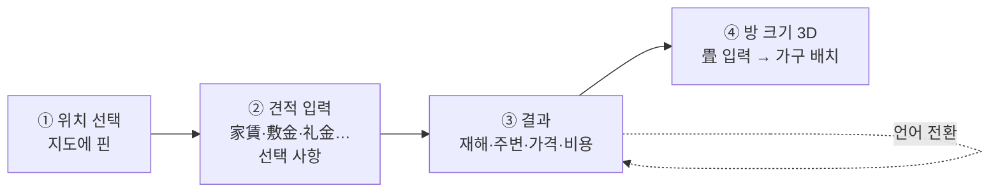
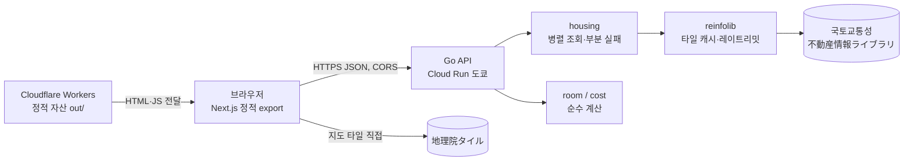

# MVP 설계서 — Kurashi Nav 「이 집, 계약해도 될까?」

> 이 문서는 **설계(무엇을·왜)** 와 **백로그(무엇부터)** 를 함께 담습니다.
> VS Code 안의 Claude Code로 개발하는 것을 전제로 작성했습니다. Claude Code는
> 이 파일의 체크박스 백로그를 `/next-task`로 하나씩 처리합니다.
> 규칙·명령어는 루트의 `CLAUDE.md`, 결정 근거는 `docs/adr/`에 있습니다.

---

## 1. 한 줄 정의

일본에서 집을 구하는 외국인이 **지도에 핀을 찍고 견적서 숫자를 넣으면**,
재해 위험·주변 정보·초기비용·방 크기를 **자기 언어로** 설명해 주는 웹 서비스.

## 2. 문제와 사용자

| | 내용 |
|---|---|
| **문제** | 해저드맵·용도지역·초기비용 항목·間取り 표기가 전부 일본어 전문용어. 부동산 회사는 "계약하라"는 쪽이라 중립적 설명을 듣기 어렵다. |
| **페르소나 A** | 한국인 유학생·워홀러(20대). 일본어 N3~N2. 1K/1R, 월세 5~8만 엔. "敷金·礼金이 뭐고 이 금액이 정상이야?" |
| **페르소나 B** | 영어권 엔지니어(30대). 일본어 거의 못 함. 1LDK/2LDK. "이 동네 홍수 위험은? 6畳면 침대랑 책상 들어가?" |
| **사용 시점** | 내견(内見) 직후 ~ 계약 전 1~3일. 휴대폰으로 사용 → **모바일 우선**. |

## 3. MVP 범위

### 넣는 것 (In)

| # | 기능 | 백엔드 상태 |
|---|---|---|
| F1 | 위치 기반 재해 정보: 홍수·고조·쓰나미·토사·액상화 | ✅ 골격 완료, 실데이터 검증 필요 |
| F2 | 주변 정보: 용도지역, 초·중학교 학구 | ✅ 골격 완료 |
| F3 | 주변 거래가격 (최근 3년, 가까운 순) | ✅ 요약 통계(`price_summary`) 완료, 실데이터 문자열 형식 검증 필요(M1-3). v1.1에서 월세 비교(R1)로 개편 예정, 매매가는 "참고"로 강등(M1-17) |
| F4 | 초기비용 분해·합계·확인할 점(경고) | ✅ 완료 |
| F5 | 방 크기 체감: 畳·㎡·평 환산, 間取り 설명, 3D 미리보기 데이터 | ✅ 완료 (3D 화면은 프론트) |
| F6 | 3개 국어: English / 한국어 / やさしい日本語 | ✅ 서버 메시지 완료 |
| F7 | 출처·면책 표시 | ✅ 완료 (크레딧 문구 확정 필요) |

### 넣지 않는 것 (Out) — 이유와 함께

| 제외 | 이유 |
|---|---|
| 매물 검색·크롤링 | 약관·법적 위험, 기존 포털 영역 (ADR-0004) |
| 매물 사진 3D 변환 | 저작권, 기존 VR 내견 존재 (ADR-0006) |
| 로그인·저장·즐겨찾기 | 사용자 입력 비저장 원칙 (ADR-0002) |
| 리뷰·커뮤니티 | 명예훼손·모더레이션 부담 |
| 광고·유료 기능 | MVP 단계 비영리. 일부 공공 데이터는 상업 이용 조건 별도 확인 필요 |
| 주소 검색 | 지도 핀으로 대체 (ADR-0005) |
| 제도 내비게이터(연금·보험·체류) | MVP 이후 두 번째 모듈 |

> **새 아이디어 규칙:** 바로 백로그에 넣지 않고 §10 "아이디어 보관함"에 적는다.
> 실사용자 피드백(M4-2)에서 요구가 나온 것만 다음 버전 백로그로 옮긴다.

## 4. 사용자 흐름 (화면 3+1개)



- ①에서 위치만 넣어도 ③이 나온다. ②는 건너뛸 수 있다.
- ③의 각 섹션은 `ok` / `unavailable` 두 상태. `unavailable`이면 "공식 자료 확인" 안내.
- ④는 ③과 독립 페이지. 숫자(6畳, 25㎡)만으로 동작.

## 5. 시스템 구성



- **호스팅 (ADR-0007):** 프론트는 **Cloudflare**, Go API는 **Cloud Run 도쿄**.
  - 프론트는 Next.js **정적 export**(`output: "export"`)로 빌드한 `out/`을
    Cloudflare Workers 정적 자산으로 배포. 모든 화면이 브라우저에서 동작하므로 SSR 불필요.
    정적 자산 요청은 무료·무제한.
  - 1단계: 브라우저가 Cloud Run API를 직접 호출(CORS 허용 목록 `ALLOWED_ORIGINS`).
  - 2단계(선택): Worker가 `/api/*`를 Cloud Run으로 프록시 → 같은 출처, 백엔드 URL 숨김, 방 크기 응답 엣지 캐시.
  - Go 백엔드를 Cloudflare로 옮기지 않는 이유: Workers는 Go를 직접 실행하지 못하고,
    Containers는 유료 플랜 전용. 지금은 Cloud Run 무료 구간이 유리.

- **모노레포:** 백엔드(루트)와 프론트(`web/`)를 한 저장소에 둔다. Claude Code가
  API 계약과 화면을 함께 보고 수정할 수 있고, CI도 하나로 관리된다.
  프론트 규칙은 `.claude/rules/web.md`에 있고, Claude Code가 `web/` 파일을 다룰 때만 불러온다.
- **MLIT API는 서버에서만 호출** (공식 매뉴얼이 브라우저 호출을 금지).
- **지도 타일은 브라우저가 직접** 地理院タイル을 불러온다 (신청 불필요, 출처 표기 필수).

## 6. API 계약 (MVP)

| Method | Path | 입력 | 출력 핵심 |
|---|---|---|---|
| `POST` | `/v1/housing/check` | `lat`, `lon`, `lang`, `cost?` | `sections[]`, `cost`, `partial`, `sources[]`, `disclaimer` |
| `GET` | `/v1/room/size` | `jo` 또는 `area_sqm`, `lang` | 환산값, `shape`, `reference_furniture[]` |
| `GET` | `/v1/room/layout` | `code`, `lang` | `parts[]`, `summary`, `min_size_guideline` |
| `GET` | `/v1/meta/sources` | — | 데이터 출처·크레딧 |
| `GET` | `/healthz` | — | 상태 |

- 에러는 모두 `{"error":{"code","message","request_id"}}`.
- 하우징 응답은 `Cache-Control: no-store`, 방 크기 응답은 `public, max-age=86400`.
- 정식 스펙은 `docs/openapi.json` (OpenAPI 3.0) → 프론트 타입 생성에 사용.
  YAML이 아닌 JSON인 이유: Go 표준 라이브러리로 읽어 테스트에서 실제 응답과 비교하기 위해서 (ADR-0001).
  `internal/server/openapi_test.go`가 응답과 스펙이 어긋나면 실패한다.

## 7. 비기능 요구

| 항목 | 목표 |
|---|---|
| 응답 시간 | 하우징 p95 ≤ 2초(타일 캐시 적중) / ≤ 6초(콜드). 방 크기 p95 ≤ 50ms |
| 가용성 | 레이어 일부 실패에도 200 + `partial: true` |
| 개인정보 | 사용자 입력 비저장·비로그·제3자 비전송. 로그는 경로·상태·시간만 |
| 외부 API 예의 | 초당 1회 + 버스트 10, 타일 24시간 캐시 |
| 비용 | 월 ¥1,000 이하 (Cloud Run 최소 인스턴스 0 + 예산 알림, Cloudflare 무료 플랜) |
| 모바일 | 375px 폭에서 가로 스크롤 없음, Lighthouse 접근성 90+ |
| 품질 | `make check` 통과, 패키지별 커버리지 70%+ (main 제외) |

## 8. 백로그

**규칙**
- 각 항목 = Claude Code **세션 1개** = 브랜치 1개 = PR 1개 크기.
- `[직접]` = 사람이 해야 하는 일 (계정·신청·사용자 인터뷰 등). `/next-task`가 건너뛴다.
- 완료 조건(DoD): `make check` 통과 · 관련 문서 갱신 · 체크박스 체크 · PR 설명(무엇/왜/검증 방법).
- 기간은 하루 2~3시간 기준 대략치.

### M0 — 준비 (1주)
- [ ] M0-1 `[직접]` GitHub `jjoonii34/kurashi-nav` 생성(Public), 첫 푸시, Actions CI 녹색 확인 → `main` 룰셋(PR 필수·`test`/`docker` 체크 필수·강제 푸시 금지), Squash 머지만 허용, 브랜치 자동 삭제, Dependabot·CodeQL 켜기
- [ ] M0-2 `[직접]` 不動産情報ライブラリ API 이용 신청 (키 발급 대기 중에도 fake 모드로 진행 가능)
- [ ] M0-3 `[직접]` VS Code에 Claude Code 확장 설치 → 폴더 열기 → 신뢰 → `/memory`로 `CLAUDE.md` 로드 확인 → 출력 스타일 `Learning` 선택 (§9.1)

### M1 — 실데이터 연결 (2~3주, 백엔드)
- [ ] M1-1 `[직접]` API 이용약관 정독 → 필수 크레딧 문구를 메모
- [ ] M1-2 크레딧 문구를 `internal/source/source.go`·`docs/DATA_SOURCES.md`에 반영, TODO 제거
- [ ] M1-3 `make run-live`로 9개 레이어 실호출, `Keep: nil`로 속성 확인 → `internal/reinfolib/endpoints.go`의 `(unverified)` 해소
- [ ] M1-4 레이어 해석기: 원시 속성 → 섹션 `summary`(등급 + 3개 국어 문장). 홍수 깊이 랭크, 토사 경계/특별경계부터 · 학습: 인터페이스 설계 (직접 작성 권장)
- [x] M1-5 거래가격 요약: ㎡단가 중앙값·사분위수, 건수, 기간 · 학습: 정렬·백분위, 테이블 테스트
- [x] M1-6 `docs/openapi.json` 작성 + 핸들러 응답과 일치하는지 검사하는 테스트
- [x] M1-7 singleflight: 같은 타일 동시 요청을 1회로 · 학습: 동시성 (직접 작성 권장)
- [x] M1-8 거래 포인트 주변 2×2 타일 조회 (타일 경계 문제). 3×3(9회 호출)이 아닌 2×2(4회)인 이유: 호출 한도(순간 10회, 이후 초당 1회) 안에서 반경 약 1km를 보장하기 위해

### M1+ — 데이터 보완 (v1.1, 요구사항: `docs/requirements/v1.1-data-gaps.md`)
- [ ] M1-9 `[직접]` e-Stat 회원가입 → 앱 ID 발급 → `.env`에 `ESTAT_APP_ID`
- [ ] M1-10 `[직접]` J-SHIS 약관·크레딧 확인, 중개수수료 고시 원문 확인 → 메모
- [ ] M1-11 R3 築年月 입력 + 구 내진기준 판정 · 학습: 날짜 경계 테이블 테스트 (판정 기준은 직접)
- [ ] M1-12 R4 중개수수료 상한 경고: 경고 2종은 `internal/cost/cost.go`에 이미 있음 → 고시 원문(M1-10)과 문턱 대조, 출처를 `docs/DATA_SOURCES.md`에 기록 (문턱은 직접)
- [ ] M1-13 `internal/mesh` 위경도 → 地域メッシュ 변환 (ADR-0011) · 학습: 좌표 연산 (**직접 작성 권장**)
- [ ] M1-14 R2 J-SHIS 클라이언트 + `earthquake` 섹션 (실호출로 `(unverified)` 해소)
- [ ] M1-15 R1-a `cmd/gen-rent` + 내장 데이터 (`make gen-rent`, ADR-0010)
- [ ] M1-16 R1-b 시구정촌 판정 (ADR 후) + `rent_benchmark` 섹션 + `area_sqm` 입력
- [ ] M1-17 F3 매매가를 "참고"로 강등, OpenAPI·문서 갱신
- [ ] M1-18 (P2) R5 시설 레이어 — 호출 예산 계산 후 결정

### M2 — 프론트엔드 `web/` (3~4주)
- [x] M2-1 `web/`에 Next.js(App Router)+TypeScript 생성, `output: "export"` 설정, `web/wrangler.jsonc`(정적 자산 `./out`), CI에 lint·build 추가 · 규칙: `.claude/rules/web.md`
- [x] M2-2 i18n 라우팅 `/en` `/ko` `/ja`, 언어 전환
- [x] M2-3 ① 위치 선택: Leaflet(ADR-0009) + 地理院タイル + 핀 + 출처 표기
- [x] M2-4 ② 견적 입력 폼 (`cost.Input` 대응, 클라이언트 검증)
- [x] M2-5 ③ 결과 화면: 섹션 카드, `unavailable` 처리, 출처·면책 푸터
- [x] M2-6 ④ 방 크기 3D: react-three-fiber로 `/v1/room/size` 렌더, 가구 드래그 배치
- [ ] M2-7 間取り 설명 위젯 (`/v1/room/layout`)
- [ ] M2-8 모바일 375px·접근성 점검, Lighthouse
- [ ] M2-9 견적 폼 필드 2개(専有面積, 築年月) + 새 결과 카드 3개(지진, 건물, 월세 비교) + 카드 순서 변경 — 백엔드 M1-11·M1-14·M1-16 이후
- [x] M2-10 홈 화면 `/[lang]`: 소개 문구, 확인할 수 있는 것, 진행 순서. 지도는 `/[lang]/map`으로 이동
- [x] M2-11 화면 다듬기: Pretendard JP 글꼴(ADR-0012), 짙은 청록 홈 히어로, 채운 입력칸·큰 버튼으로 통일


### M3 — 인프라 (2~3주, `infra/README.md` 체크리스트)

**Cloudflare (프론트)** — 먼저 해도 됨. API 키 없이 fake 모드 백엔드로도 화면 확인 가능
- [ ] M3-1 `[직접]` Cloudflare 계정 생성, `wrangler login`
- [ ] M3-2 `web/` 첫 배포(`wrangler deploy`) → `*.workers.dev` 주소 확인
- [ ] M3-3 자동 배포: Cloudflare Git 연동(Workers Builds) 또는 GitHub Actions + wrangler 중 선택 → ADR로 기록

**Google Cloud (API)**
- [ ] M3-4 `[직접]` GCP 프로젝트·결제·예산 알림
- [ ] M3-5 Artifact Registry·Secret Manager·서비스 계정 (최소 권한)
- [ ] M3-6 Cloud Run 수동 배포 + `/healthz` 스모크 테스트, `ALLOWED_ORIGINS`에 workers.dev·도메인 추가
- [ ] M3-7 GitHub Actions CD (Workload Identity Federation, 태그 시 배포)
- [ ] M3-8 Terraform으로 코드화 (`infra/terraform/`, Cloudflare 리소스 포함 여부도 결정)
- [ ] M3-9 모니터링: 업타임 체크, 5xx 알림, `layer lookup failed` 로그 지표

**연결**
- [ ] M3-10 `[직접]` 도메인 구입(Cloudflare Registrar 등) → 프론트 커스텀 도메인 연결
- [ ] M3-11 (선택) `/api/*` 프록시 Worker: 같은 출처, `/v1/room/*` 엣지 캐시, 요청 본문 로그 금지 (ADR-0007 2단계)

### M4 — 출시·피드백 (2주)
- [ ] M4-1 이용약관·개인정보 처리방침·면책 페이지 (3개 국어)
- [ ] M4-2 `[직접]` 실사용자 5명 테스트 (일본 거주 외국인 지인), 피드백 → §10 정리
- [ ] M4-3 README에 데모 GIF·스크린샷, 일본어 README(`README.ja.md`)
- [ ] M4-4 `[직접]` 기술 블로그 1편 (Zenn/Qiita, 일본어) — 예: 「Goで並行タイル取得と部分失敗を設計する」

### 순서 변경 제안 (v1.1 요구사항 — 승인 전, 위 백로그에는 아직 반영하지 않음)
- M3-1~3 (Cloudflare 배포)을 M3-4 이전에 먼저 → fake/실데이터로 공개 URL 확보
- M4-2 (실사용자 5명 테스트)를 M3-4 (GCP) 이전으로 이동 — 인프라 투자 전에 검증
- 배포 전 성공 기준 정하기 `[직접]` (예: 5명 중 3명이 계약 전에 실제 사용, 한 달 방문 100회)

### 외부 일정
- [ ] `[직접]` 「イチBizアワード2026」不動産情報活用部門 응모 — 마감 2026-12-10(목) 20:00 JST (마감·응모 자격은 공식 사이트에서 확인 필요)

## 9. Claude Code로 개발하는 방법

### 9.1 처음 한 번 설정 (M0-3)

1. VS Code에 **Claude Code 확장** 설치 → 이 저장소 폴더 열기 → Claude Code 패널 열기.
2. 처음 열 때 폴더를 **신뢰(trust)** 해야 `.claude/settings.json`의 허용 규칙이 적용된다.
3. `/memory` 실행 → `CLAUDE.md`가 목록에 있는지 확인.
4. `/` 메뉴 → **Output styles** → `Learning` 선택.
   - Learning: Claude가 설명(Insight)을 붙이고, 설계 판단이 필요한 몇 줄은 `TODO(human)`으로 비워 두고 **직접 작성을 요청**한다.
   - 손에 익으면 `Explanatory`(설명만, 코드는 Claude가 작성)로 바꿔도 된다.
5. 이 저장소에 들어 있는 것:

| 파일 | 역할 |
|---|---|
| `CLAUDE.md` | 매 세션 자동으로 읽히는 규칙: 명령어, 구조, 금지 사항 |
| `.claude/settings.json` | 권한(`make`·`go test` 등은 묻지 않음, `.env` 읽기 금지) + 편집 후 `gofmt` 자동 실행 훅 |
| `.claude/rules/web.md` | `web/` 작업 때만 불러오는 프론트 규칙 (정적 export·Cloudflare 배포 제약) |
| `.claude/skills/next-task` | `/next-task [ID]` — 백로그 1개를 계획→구현→검증→문서까지 |
| `.claude/skills/verify` | `/verify` — `make check` 실행, 실패 원인을 한국어로 설명 |
| `.claude/skills/explain` | `/explain <경로>` — 탑다운 설명 + 확인 질문 3개 |
| `.claude/skills/adr` | `/adr <제목>` — 다음 번호의 ADR 작성 |

### 9.2 작업 1개의 흐름 (탑다운)

```
새 대화 탭 열기
  → /next-task M1-5            ① 목표·완료조건 3줄 확인
  → 계획 검토 (탑다운)          ② "왜 이 구조?" 질문, 필요하면 수정 요청
  → 승인 → 구현                 ③ TODO(human) 나오면 직접 작성
  → /verify                     ④ 실패하면 원인 설명 듣고 같이 수정
  → /explain internal/<pkg>     ⑤ 바뀐 부분 복습, 확인 질문에 답해 보기
  → 커밋·PR (직접)              ⑥ 메시지는 Claude가 제안한 것 참고
대화 종료 → 다음 작업은 새 탭
```

- 여러 패키지를 건드리는 작업은 시작 전에 `/plan`으로 계획만 먼저 받는다.
- 파일 일부를 물어볼 때: 에디터에서 줄을 선택하고 `Alt+K`(Mac은 `Option+K`)로 `@파일#줄` 참조를 넣는다.
- 결과가 마음에 안 들면 메시지에 마우스를 올려 **되감기(rewind)** 로 코드 변경을 되돌릴 수 있다.

### 9.3 무엇을 맡기고 무엇을 직접 하나

| Claude에게 맡김 | 직접 작성 (Claude는 설계 제안·리뷰) |
|---|---|
| 보일러플레이트, 핸들러 연결, JSON 구조체 | 도메인 규칙 (위험 등급 해석, 비용 경고 기준) |
| 테스트 케이스 확장, 문서 갱신 | 동시성 (singleflight, 캐시 교체) |
| 프론트 UI 마크업·스타일 | 에러 처리 설계, 인터페이스 경계 |
| CI·Dockerfile 수정 | ADR의 "결정"과 "이유" |

기준: **면접에서 "이 줄은 왜 이렇게 했나요?"에 답할 수 있어야 하는 부분은 직접.**

### 9.4 프롬프트 예시

- `M1-5 하자. 계획만 먼저 보여줘. 중앙값 계산 함수는 내가 직접 쓸게.`
- `@internal/housing/service.go lookupAll이 왜 mutex 없이 안전한지 탑다운으로 설명해줘.`
- `방금 변경을 리뷰해줘. 개인정보 규칙(ADR-0002) 위반 가능성 위주로.`
- `이 에러 메시지 원인 찾아줘. 코드는 고치지 말고 원인만.`
- `이 결정 ADR로 남겨줘: 거래가격 요약을 서버에서 계산하는 이유`

### 9.5 컨텍스트·안전 수칙

- **작업 1개 = 대화 1개.** 길어지면 새 탭에서 시작한다 (CLAUDE.md와 이 문서가 맥락을 이어 준다).
- API 키는 `.env`에만. 채팅에 붙여 넣지 않는다 (`.env` 읽기는 설정으로 차단돼 있음).
- 커밋·푸시는 항상 직접 확인 후. `.claude/settings.json`에서 묻도록 설정돼 있다.
- 개인 설정(출력 스타일 등)은 `.claude/settings.local.json`에 저장되고 git에 올라가지 않는다.

## 10. 리스크와 아이디어 보관함

### 리스크

| 리스크 | 대응 |
|---|---|
| API 키 발급 지연 | fake 모드로 M2(프론트)와 M3-1~3(Cloudflare 배포)를 먼저 진행 |
| 정적 export 한계(SSR 필요 기능 등장) | 그때 vinext/OpenNext 검토 후 ADR. MVP 화면은 전부 클라이언트 동작이라 해당 없음 |
| API 약관에 예상 못 한 제약 | M1-1에서 확인 후 ADR로 기록, 범위 조정 |
| MLIT 접근 제한 | 타일 캐시·레이트리밋 유지, 요청 수 지표 관찰 |
| 범위 확장 | 새 아이디어는 아래 보관함으로. 피드백 없이는 백로그로 안 옮김 |
| Claude 의존으로 실력 미형성 | §9.3 기준 준수, 매 작업 후 `/explain` 확인 질문 |

### 아이디어 보관함 (MVP 이후 후보)

- 매물 사진 3D 변환 — 보류 (ADR-0006)
- AI 추천 매물 — 보류. 매물 데이터가 없고(ADR-0004), 위치·예산을 LLM에 보내야 해서 사용자 입력 비전송 원칙과 충돌
- 제도 내비게이터: 국민연금 학생납부특례·탈퇴일시금, 국보 감면, 주민세, 체류 갱신
- 原状回復 체크리스트 (국토교통성 가이드라인 비공식 번역)
- 계약서 용어집 (外国人の民間賃貸住宅入居円滑化ガイドライン 기반)
- PWA·오프라인
- 자체 지오코더 (アドレス・ベース・レジストリ)
